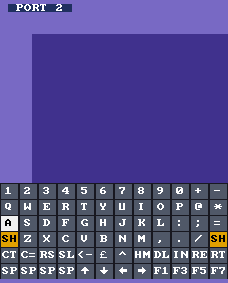

# Input

## Pocket pads

| Button  | Joystick (default)   | Keys        | Keyboard shown      |
|---------|----------------------|-------------|---------------------|
| D-pad   | joystick             | cursor keys | move the key cursor |
| A       | fire (+ paddle button with *Paddles* on) | Space | press the key |
| B       | Space                | Return      | close the keyboard  |
| X       | Return               | F1          | -                   |
| Y       | F1                   | F3          | -                   |
| L       | Run/Stop             | Run/Stop    | -                   |
| R       | F7                   | F5          | -                   |
| Select  | show the keyboard    | show the keyboard | close         |
| Start   | -> keys              | -> joystick | -                   |

*Pad Mode* picks the starting mode; Start switches it and a label shows the new mode for ~2 s. The VIC-20
has one joystick port: pads 1 and 2 both drive it. With *Paddles = Analog Sticks*, the left stick's X of
Dock controllers 1 and 2 (type 3, analog) turns paddles 1 and 2; their buttons are A (VIC20.sv's "Paddle
Fire", the joystick's right / left lines).

## On-screen keyboard

Select opens a 12×6 keyboard at the bottom of the picture (`osk.sv`; 19-pixel cells on PAL's 228-pixel
line, 17 on NTSC's 204). CTRL, SHIFT and C= are sticky: press them once, then the key; they release with it.
Other keys are held for as long as A is held. While the keyboard is shown the joystick is disconnected.

Two-letter labels: `RS` Run/Stop, `RE` Restore, `HM` Clr/Home, `DL` Inst/Del, `IN` Inst, `RT` Return,
`SL` Shift Lock, `CT` CTRL, `SH` Shift, `SP` Space, `<-` and `^` the left-arrow and up-arrow keys. The
layout is `LAYOUT` in `tools/gen_osk.py`, which generates `src/fpga/core/osk_layout.svh` and the font ROM
`osk_font.hex` (font8x8 by Daniel Hepper, public domain, plus arrow and pound glyphs). Re-run it after
editing: `python3 tools/gen_osk.py tools/font8x8_basic.h`. On a picture under 256 pixels the loading
screen uses 8-pixel characters.

## Autostart

`autostart.sv` saves typing on the handheld. Picking a program, a disk (drive 8) or a tape arms it for
8 s; if the VIC-20 reaches the BASIC prompt in that time, it types, through `hid_c64`:

* program: `RUN` Return, once `vic20_top` has stored it and set BASIC's pointers (`prg_loaded`);
* disk: `LOAD"*",8,1` Return; when BASIC's prompt is back after the load, `RUN` Return, but only if the CPU
  ran BASIC's direct-mode loop at `$C483` after the load (a program that started itself gets no `RUN`);
* tape: Shift + Run/Stop, which makes the KERNAL load and run the tape's first program.

"At the prompt" is `vic20_top`'s `at_prompt`: the CPU spending over 1/16 of a ~30 ms window in the
KERNAL's key wait loop at `$E5E8`–`$E5F0`. Timing, `disk_ready` and reset rules are the C64 port's. A
cartridge needs no typing: loading one resets the VIC-20, and the KERNAL starts a cartridge at `$A000`.
*Autostart = Off* disables it.

## Dock keyboard

The Dock reports a USB keyboard as player 3 (`cont3_key[31:28]` = 4): `{cont3_joy, cont3_trig}` holds up
to six HID usages, `cont3_key[15:8]` the modifier byte. `hid_c64` turns these, and the keys made by the
pad and the on-screen keyboard, into the `ps2_key` words MiSTer's `hps_io` produces, so VIC20_MiSTer's
`fpga64_keyboard` is used unchanged (its matrix is the C64's): Esc = Run/Stop, Tab or Alt = C=,
Backspace = Inst/Del, Home = Clr/Home, F11 = Restore, F9 = ↑, `` ` `` = ←, `[` = @, `]` = *, `\` = £,
Page Up = tape play. `hid_c64` still has its mouse path; the VIC-20 has no mouse, so it is tied off.

## Not supported

Two simultaneous non-modifier keys from the on-screen keyboard; a Dock mouse.
